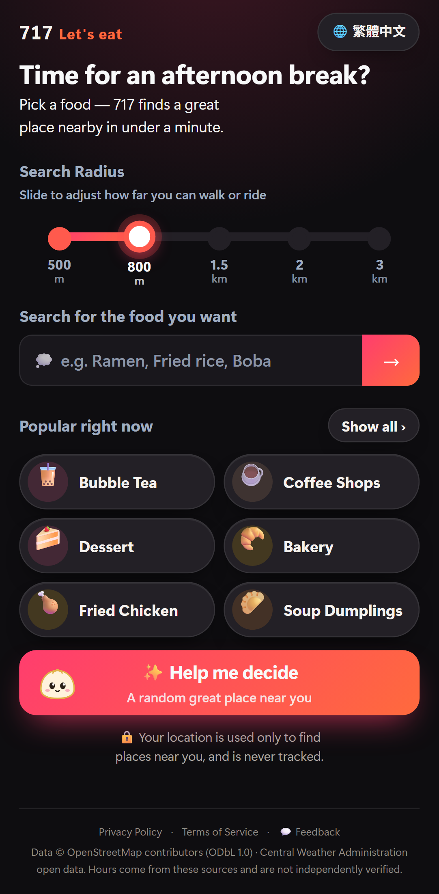
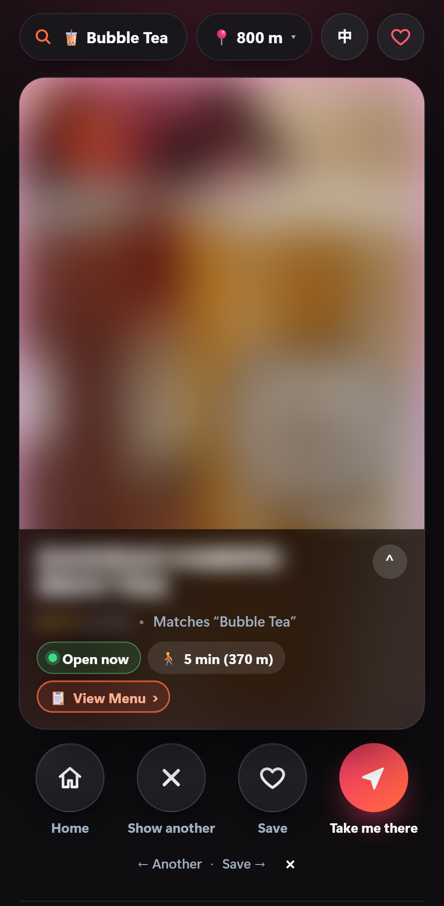
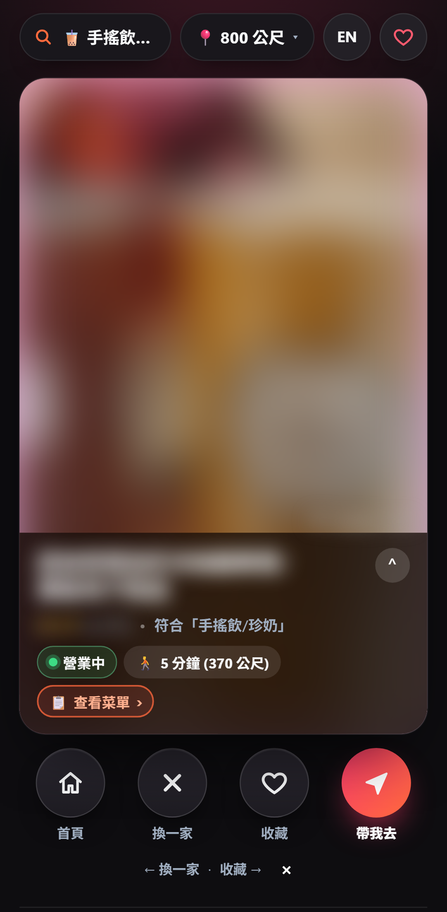
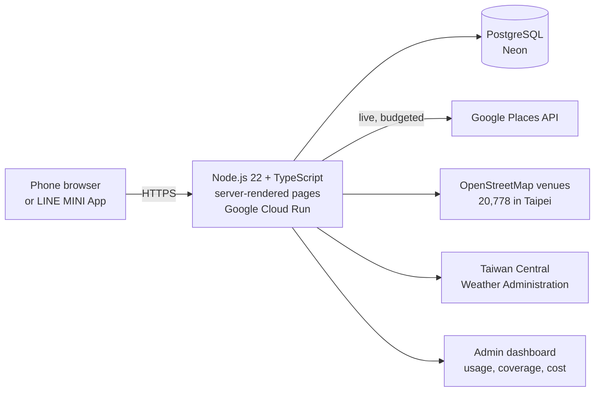

# SwipeBite: decide where to eat in one tap

**Live:** [swipebite-1042041082295.asia-southeast1.run.app](https://swipebite-1042041082295.asia-southeast1.run.app/) · also runs inside LINE as the MINI App **717 吃一吃**

This repository is the public case study. The source code is private; I'm happy to walk through it in an interview.

  
  
  

The restaurant photo, name and rating come from Google and are blurred here, because Google content is shown live in the app and never republished.

---

## The problem

Choosing where to eat in Taipei means opening Google Maps, filtering, reading reviews and comparing dozens of places. Before writing any code I asked **100+ people**:

- **98 of 100** said a dedicated app would be better than their current approach.
- They spend **8–10 minutes** per search, and about **18 minutes** to find a new place that fits.

Google Maps helps you *search*. Delivery apps are *catalogues* limited to their partners. **SwipeBite decides.** It gives one open place you can walk to, based on where you are and the time of day. There's no sign-up.

## How it works

1. Pick how far you can go (500 m to 3 km), then tap a food, type one, or tap **Help me decide**.
2. You get **one** card: open now, minutes on foot, price level and the menu.
3. **Take me there** opens walking directions. **Show another** or **Save** keep you in the app.
4. Each skip and save adjusts the next pick within the session.

## Architecture

## Engineering decisions I'm proud of

| Decision | Why |
|---|---|
| **Never recommend a place whose hours can't be confirmed** | A closed restaurant breaks trust faster than any other mistake. Unknown hours are filtered out, not guessed. |
| **Google API spending fails closed** | Daily and per-person limits on every paid call type, plus a circuit breaker. When a limit is reached the app falls back to its own OpenStreetMap data rather than spending more. |
| **Privacy by design** | No accounts. Locations are stored only as a ~500 m area, never a precise point, and never tracked over time. API keys never reach the browser or the logs. |
| **Dish-level matching** | "Sushi" used to return any Japanese place, including a fried-chicken shop. Named dishes are now searched by name, and places that prove they serve the dish rank first. |
| **Built for Taiwan** | Traditional Chinese and English. Distances and minutes never show the number 4, because it sounds like "death" in Chinese. |
| **Safe pages** | A strict Content-Security-Policy with a per-request nonce, and a test that parses every page script after a single lost backslash broke a page in production. |

## Results (from the production database)

Launch period: **29 Sep – 7 Oct 2026** (first 9 days). Team and test devices are excluded.

| Metric | Value |
|---|---|
| Unique visitors | **109** |
| Searches | **164** |
| Restaurant cards shown | **323** |
| Visitors who saw a card and chose **Take me there** | **38.7%** (12 of 31) |
| Median time from opening the app to choosing | **38 s** (11 decisions, small sample) |
| Server response for a recommendation, median / p95 | **117 ms / 1.09 s** (1,418 requests, 7 Sep – 7 Oct) |

**A data-driven fix:** the dashboard showed that many searches ended with no result, because the first batch of nearby places was mostly closed. Fetching more open places cut the no-result rate from **32% (100 searches) to 17% (30 searches)** in the following days. The "after" sample is still small.

## Quality

- **966 automated tests**, plus a TypeScript type check, run before every deploy.
- Real-device checks on iPhone SE, Pixel 7 and laptop, in light and dark mode and with large text.
- An admin dashboard with a per-day journal of searches, results and problems. It's how the no-result issue above was found.

## Tech

TypeScript · Node.js 22 · PostgreSQL (Neon; PGlite in tests) · Google Cloud Run · Google Places API · OpenStreetMap · LINE LIFF / MINI App · Leaflet · Playwright

## My role

Solo project, from user research to production. I made the product and design decisions, built and tested it with AI-assisted development tools, deployed it on Google Cloud, and run it day to day from the usage data.

---

[LinkedIn](https://www.linkedin.com/in/venkata-naveen-vadlamudi) · [GitHub profile](https://github.com/Naveen-vadlamudi)
